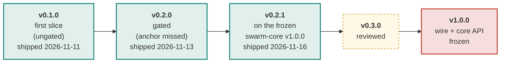
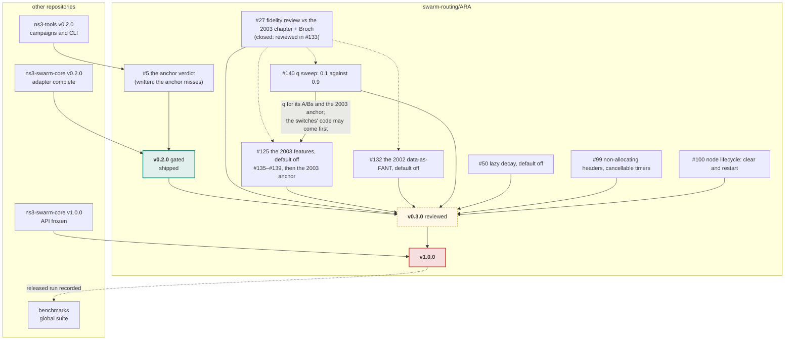

# Roadmap

The plan for ARA in one page. The live plan is this page plus the `release:`
labels below; issue state is always truer than a checked-in diagram. The ladder
was adopted by the maintainer on 2026-11-11 ("adopt the release ladder and
replace the phase-targets rule"), on the model of
[AntHocNet's roadmap](https://github.com/swarm-routing/AntHocNet/blob/main/docs/roadmap.md).
The org-wide train that orders this repository against the others is in the
[org ROADMAP](https://github.com/swarm-routing/.github/blob/main/ROADMAP.md).

## How this plan is tracked

Each issue a release gates carries that release's **`release:` label**, so
every row of this plan is a live query rather than a diagram that drifts:

| Release | Board |
|---|---|
| v0.2.0 | [`release:v0.2.0`](https://github.com/swarm-routing/ARA/issues?q=is%3Aopen+label%3A%22release%3Av0.2.0%22) |
| v0.3.0 | [`release:v0.3.0`](https://github.com/swarm-routing/ARA/issues?q=is%3Aopen+label%3A%22release%3Av0.3.0%22) |
| v1.0.0 | [`release:v1.0.0`](https://github.com/swarm-routing/ARA/issues?q=is%3Aopen+label%3A%22release%3Av1.0.0%22) |
| all epics | [`epic`](https://github.com/swarm-routing/ARA/issues?q=is%3Aopen+label%3Aepic) |

Only issues a release actually gates are labelled, one release label per
issue. Unscheduled work lands whenever it lands; the infrastructure track
rides along and never gates. Majors are reserved for breaking changes, and
1.0.0 is the stability promise.

## Release ladder

Green is shipped; amber is planned. v0.1.0 shipped on 2026-11-11 ([release
v0.1.0](https://github.com/swarm-routing/ARA/releases/tag/v0.1.0)), ungated:
the core's first slice and the `ara` module building on swarm-core. v0.2.0
shipped on 2026-11-13 ([release
v0.2.0](https://github.com/swarm-routing/ARA/releases/tag/v0.2.0), Zenodo
version DOI
[10.5281/zenodo.24202635](https://doi.org/10.5281/zenodo.24202635)), gated:
the anchor missed, and the release ships with the written infeasibility
verdict ([benchmarks/v0.2.0-anchor.md](benchmarks/v0.2.0-anchor.md)). v0.2.1
shipped on 2026-11-16 ([release
v0.2.1](https://github.com/swarm-routing/ARA/releases/tag/v0.2.1), Zenodo
version DOI
[10.5281/zenodo.24269622](https://doi.org/10.5281/zenodo.24269622)), the
patch built on the frozen swarm-core v1.0.0.

## What blocks what

Solid arrows are hard dependencies; dashed are "informs". Cross-repository
dependencies are the org release train's: this repository's v0.2.0 is in wave
B and cannot ship before ns3-tools v0.2.0 and ns3-swarm-core v0.2.0.

## What each release must show to ship

| Release | Exit criteria |
|---|---|
| **v0.1.0** | The core's first slice (route discovery: FANT/BANT, trails, evaporation, next hop, discovery retries, the ant wire header) builds and tests alone and inside ns-3 as the contrib module `ara`, carried out on swarm-core's `SwarmRoutingBase`. **Shipped 2026-11-11** ([release v0.1.0](https://github.com/swarm-routing/ARA/releases/tag/v0.1.0)), ungated. |
| **v0.2.0** "gated" | The module is green; swarm-core's router observer is adopted; ARA has its own benchmark pipeline; the anchor verdict is in (PASS, or a written infeasibility verdict); the fidelity open items are settled. Scope: the rest of [#5](https://github.com/swarm-routing/ARA/issues/5): duplicate errors and route-failure backtracking are in (core and adapter), and its anchor verdict is written: the anchor misses, recorded as a written infeasibility verdict ([`benchmarks/v0.2.0-anchor.md`](benchmarks/v0.2.0-anchor.md), 2026-11-13). [#36](https://github.com/swarm-routing/ARA/issues/36) (paired smoke and anchor campaigns on the org reusable cell workflow), [#51](https://github.com/swarm-routing/ARA/issues/51) (hot-path pheromone reads off `entries()`, swarm-core#47) and the observer item, [#41](https://github.com/swarm-routing/ARA/issues/41) (its CI checks and adapter coverage landed), are closed, so they no longer gate. Needs ns3-tools v0.2.0 and ns3-swarm-core v0.2.0 (wave B). **Shipped 2026-11-13** ([release v0.2.0](https://github.com/swarm-routing/ARA/releases/tag/v0.2.0), Zenodo version DOI [10.5281/zenodo.24202635](https://doi.org/10.5281/zenodo.24202635)), with the written infeasibility verdict. |
| **v0.2.1** "on the frozen swarm-core" | **Shipped 2026-11-16** ([release v0.2.1](https://github.com/swarm-routing/ARA/releases/tag/v0.2.1), Zenodo version DOI [10.5281/zenodo.24269622](https://doi.org/10.5281/zenodo.24269622)). A patch release built on swarm-core v1.0.0, whose API is frozen (swarm-routing/ns3-swarm-core#83): `swarm-core.lock` locks v1.0.0 (org-bot's pin bump, #184) and CI is green on it, with no API change on either side. It also ships what `main` gained since v0.2.0 without changing the protocol: `core/` at C++23 (#160), swarm-core consumed by release (#159) and from its vcpkg port (#176), `core/` installed as the CMake package `ara-core` and its vcpkg port (#168, #170), and `core::Config` as ns-3 attributes with the core's defaults (#134). Forced to a patch (`increment: PATCH`) by the maintainer's decision of 2026-11-16 (swarm-routing/ns3-swarm-core#83); the comparator gates are v0.2.0's, unchanged. |
| **v0.3.0** "reviewed" | **Exit criteria:** (1) every `release:v0.3.0` issue is closed against its acceptance criteria; (2) each new mechanism is behind a default-off switch, exposed as an ns-3 attribute, with core unit tests and the default path byte-identical (the determinism gate and the smoke's marker lines, stated in its PR); (3) each switch's paired A/B (≥ 20 seeds, the two smoke families and the anchor's pause 0 and 30 s cells) is read with `ns3-campaign verdicts` and posted on its issue; (4) every reading of a paper is pre-registered on its issue and accepted by the maintainer before its code (org rule 11); (5) the 2003 anchor is pre-registered as a new plan, `check_plan_deps.py` ok before its first dispatch, and its verdict, PASS or a written infeasibility verdict, is in `docs/benchmarks/v0.3.0-anchor.md` with the raw cells in `results/cells/`; (6) `docs/fidelity.md` names every switch and its source; (7) no default moves without its A/B and a maintainer decision; (8) CI green on `main` on the supported ns-3 release. **Scope:** the paper-review issues, performance follow-ups and default-off A/Bs. [#27](https://github.com/swarm-routing/ARA/issues/27), the fidelity sheet reviewed against the authors' 2003 chapter (Günes & Spaniol, IFIP Net-Con 2003, <https://doi.org/10.1007/978-0-387-35703-4_9>) and Broch et al. (MobiCom 1998) in #133, is closed (2026-11-22): the maintainer accepted the 2003 chapter in place of the Med-Hoc-Net 2003 paper ("ARA2"), which is not held; its open questions have the tickets below. Open: [#125](https://github.com/swarm-routing/ARA/issues/125) (the 2003 features behind default-off switches, then a pre-registered anchor on the 2003 trend, after the v0.2.0 anchor's miss; one ticket per feature: [#135](https://github.com/swarm-routing/ARA/issues/135) statistical path selection, [#136](https://github.com/swarm-routing/ARA/issues/136) flooded BANTs, [#137](https://github.com/swarm-routing/ARA/issues/137) ant priority, [#138](https://github.com/swarm-routing/ARA/issues/138) one more try on a failed link, [#139](https://github.com/swarm-routing/ARA/issues/139) the MAC-Tap; the send buffer is `BufferDuringDiscovery`), [#132](https://github.com/swarm-routing/ARA/issues/132) (the 2002 version's data packet sent as the FANT, behind a default-off switch, found by #27's review), [#140](https://github.com/swarm-routing/ARA/issues/140) (the q sweep, 0.1 against 0.9, the two readings of the 2003 chapter; first, since it sets q for the A/Bs; swept and read, [`benchmarks/q-sweep.md`](benchmarks/q-sweep.md), and open only on the maintainer's decision on the default), [#50](https://github.com/swarm-routing/ARA/issues/50) (lazy on-read pheromone decay behind a default-off switch, A/B against the eager sweep), [#99](https://github.com/swarm-routing/ARA/issues/99) (swarm-core's non-allocating header path and cancellable timers), [#100](https://github.com/swarm-routing/ARA/issues/100) (clear and restart on node shutdown, crash and start, on swarm-core's lifecycle hooks, so a failure benchmark never sees a restarted node's old trails). |
| **v1.0.0** | Wire format and `core/` API frozen; paper-faithful with the deviations documented; the three gates passed (fidelity sheet, per-PR delivery smoke, anchor); green on the supported ns-3 release; a released run recorded in the benchmarks global suite. Follows ns3-swarm-core v1.0.0 (two gated protocols on it unchanged), and needs the release workflow's `increment` input for a major (a swarm-routing/.github ticket). |

## Infrastructure track

CI, packaging and tooling items ride along with whichever release is cut
next, carry no `release:` label (that label is reserved for issues a release
gates), and never gate a release. The
checks and adapter coverage of [#41](https://github.com/swarm-routing/ARA/issues/41)
are the example: done, and not an exit criterion.

## Deliberate non-goals

Not planned for 1.0.0, kept as issues for after it:

- The trust-weighted ACO comparator
  ([#9](https://github.com/swarm-routing/ARA/issues/9)) and the ACO + watchdog
  comparator (Kalinin et al. 2018,
  [#10](https://github.com/swarm-routing/ARA/issues/10)): security comparators
  wait until the protocol itself is gated and frozen.
- Any change that moves a default without a default-off switch and an A/B on
  identical seeds (org golden rule 6; AntHocNet golden rule 8).

## See also

- The [org ROADMAP](https://github.com/swarm-routing/.github/blob/main/ROADMAP.md): the cross-repository release train (waves A to E).
- [CONTRIBUTING](https://github.com/swarm-routing/.github/blob/main/CONTRIBUTING.md): invariants, issues and labels.
- [`fidelity.md`](fidelity.md): the paper-to-implementation sheet the gates rest on.
- [AntHocNet's roadmap](https://github.com/swarm-routing/AntHocNet/blob/main/docs/roadmap.md): the model for this page.

## Shipped releases

Every published release with its Zenodo version DOI, read from Zenodo by swarm-routing/.github `tools/zenodo/zenodo.py shipped` (org-bot's `release-aftercare` task); never edit the block by hand.

<!-- releases:shipped:begin (zenodo.py shipped --write; never edit by hand) -->
- **v0.2.1** shipped 2026-11-16 ([release](https://github.com/swarm-routing/ARA/releases/tag/v0.2.1), Zenodo version DOI [10.5281/zenodo.24269622](https://doi.org/10.5281/zenodo.24269622))
- **v0.2.0** shipped 2026-11-13 ([release](https://github.com/swarm-routing/ARA/releases/tag/v0.2.0), Zenodo version DOI [10.5281/zenodo.24202635](https://doi.org/10.5281/zenodo.24202635))
- **v0.1.0** shipped 2026-11-11 ([release](https://github.com/swarm-routing/ARA/releases/tag/v0.1.0), Zenodo version DOI [10.5281/zenodo.24125199](https://doi.org/10.5281/zenodo.24125199))
<!-- releases:shipped:end -->
