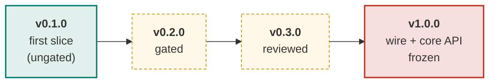
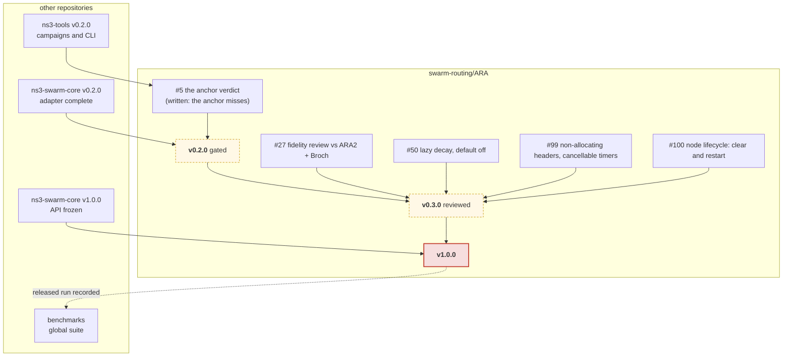

# Roadmap

The plan for ARA in one page. The live plan is this page plus the `release:`
labels below; issue state is always truer than a checked-in diagram. The ladder
was adopted by the maintainer on 2026-11-11 ("adopt the release ladder and
replace the phase-targets rule"), on the model of
[AntHocNet's roadmap](https://github.com/swarm-routing/AntHocNet/blob/main/docs/roadmap.md).
The org-wide train that orders this repository against the others is in the
[org ROADMAP](https://github.com/swarm-routing/.github/blob/main/ROADMAP.md).

## How this plan is tracked

Each issue a release gates carries that release's **`release:` label**, so
every row of this plan is a live query rather than a diagram that drifts:

| Release | Board |
|---|---|
| v0.2.0 | [`release:v0.2.0`](https://github.com/swarm-routing/ARA/issues?q=is%3Aopen+label%3A%22release%3Av0.2.0%22) |
| v0.3.0 | [`release:v0.3.0`](https://github.com/swarm-routing/ARA/issues?q=is%3Aopen+label%3A%22release%3Av0.3.0%22) |
| v1.0.0 | [`release:v1.0.0`](https://github.com/swarm-routing/ARA/issues?q=is%3Aopen+label%3A%22release%3Av1.0.0%22) |
| all epics | [`epic`](https://github.com/swarm-routing/ARA/issues?q=is%3Aopen+label%3Aepic) |

Only issues a release actually gates are labelled, one release label per
issue. Unscheduled work lands whenever it lands; the infrastructure track
rides along and never gates. Majors are reserved for breaking changes, and
1.0.0 is the stability promise.

## Release ladder

Green is shipped; amber is planned. v0.1.0 shipped on 2026-11-11 ([release
v0.1.0](https://github.com/swarm-routing/ARA/releases/tag/v0.1.0)), ungated:
the core's first slice and the `ara` module building on swarm-core.

## What blocks what

Solid arrows are hard dependencies; dashed are "informs". Cross-repository
dependencies are the org release train's: this repository's v0.2.0 is in wave
B and cannot ship before ns3-tools v0.2.0 and ns3-swarm-core v0.2.0.

## What each release must show to ship

| Release | Exit criteria |
|---|---|
| **v0.1.0** | The core's first slice (route discovery: FANT/BANT, trails, evaporation, next hop, discovery retries, the ant wire header) builds and tests alone and inside ns-3 as the contrib module `ara`, carried out on swarm-core's `SwarmRoutingBase`. **Shipped 2026-11-11** ([release v0.1.0](https://github.com/swarm-routing/ARA/releases/tag/v0.1.0)), ungated. |
| **v0.2.0** "gated" | The module is green; swarm-core's router observer is adopted; ARA has its own benchmark pipeline; the anchor verdict is in (PASS, or a written infeasibility verdict); the fidelity open items are settled. Scope: the rest of [#5](https://github.com/swarm-routing/ARA/issues/5): duplicate errors and route-failure backtracking are in (core and adapter), and its anchor verdict is written: the anchor misses, recorded as a written infeasibility verdict ([`benchmarks/v0.2.0-anchor.md`](benchmarks/v0.2.0-anchor.md), 2026-11-13). [#36](https://github.com/swarm-routing/ARA/issues/36) (paired smoke and anchor campaigns on the org reusable cell workflow), [#51](https://github.com/swarm-routing/ARA/issues/51) (hot-path pheromone reads off `entries()`, swarm-core#47) and the observer item, [#41](https://github.com/swarm-routing/ARA/issues/41) (its CI checks and adapter coverage landed), are closed, so they no longer gate. Needs ns3-tools v0.2.0 and ns3-swarm-core v0.2.0 (wave B). |
| **v0.3.0** "reviewed" | The paper-review issues, performance follow-ups and default-off A/Bs: [#27](https://github.com/swarm-routing/ARA/issues/27) (review the fidelity sheet against ARA2, Med-Hoc-Net 2003, and Broch et al., MobiCom 1998, once in hand), [#125](https://github.com/swarm-routing/ARA/issues/125) (the 2003 features behind default-off switches, then a pre-registered anchor on the 2003 trend, after the v0.2.0 anchor's miss), [#50](https://github.com/swarm-routing/ARA/issues/50) (lazy on-read pheromone decay behind a default-off switch, A/B against the eager sweep), [#99](https://github.com/swarm-routing/ARA/issues/99) (swarm-core's non-allocating header path and cancellable timers), [#100](https://github.com/swarm-routing/ARA/issues/100) (clear and restart on node shutdown, crash and start, on swarm-core's lifecycle hooks, so a failure benchmark never sees a restarted node's old trails). |
| **v1.0.0** | Wire format and `core/` API frozen; paper-faithful with the deviations documented; the three gates passed (fidelity sheet, per-PR delivery smoke, anchor); green on the supported ns-3 release; a released run recorded in the benchmarks global suite. Follows ns3-swarm-core v1.0.0 (two gated protocols on it unchanged), and needs the release workflow's `increment` input for a major (a swarm-routing/.github ticket). |

## Infrastructure track

CI, packaging and tooling items ride along with whichever release is cut
next, carry no `release:` label (that label is reserved for issues a release
gates), and never gate a release. The
checks and adapter coverage of [#41](https://github.com/swarm-routing/ARA/issues/41)
are the example: done, and not an exit criterion.

## Deliberate non-goals

Not planned for 1.0.0, kept as issues for after it:

- The trust-weighted ACO comparator
  ([#9](https://github.com/swarm-routing/ARA/issues/9)) and the ACO + watchdog
  comparator (Kalinin et al. 2018,
  [#10](https://github.com/swarm-routing/ARA/issues/10)): security comparators
  wait until the protocol itself is gated and frozen.
- Any change that moves a default without a default-off switch and an A/B on
  identical seeds (org golden rule 6; AntHocNet golden rule 8).

## See also

- The [org ROADMAP](https://github.com/swarm-routing/.github/blob/main/ROADMAP.md): the cross-repository release train (waves A to E).
- [CONTRIBUTING](https://github.com/swarm-routing/.github/blob/main/CONTRIBUTING.md): invariants, issues and labels.
- [`fidelity.md`](fidelity.md): the paper-to-implementation sheet the gates rest on.
- [AntHocNet's roadmap](https://github.com/swarm-routing/AntHocNet/blob/main/docs/roadmap.md): the model for this page.
